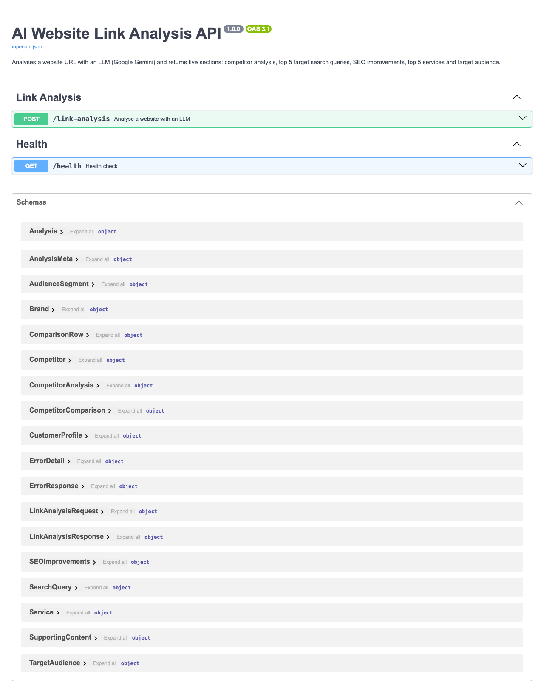
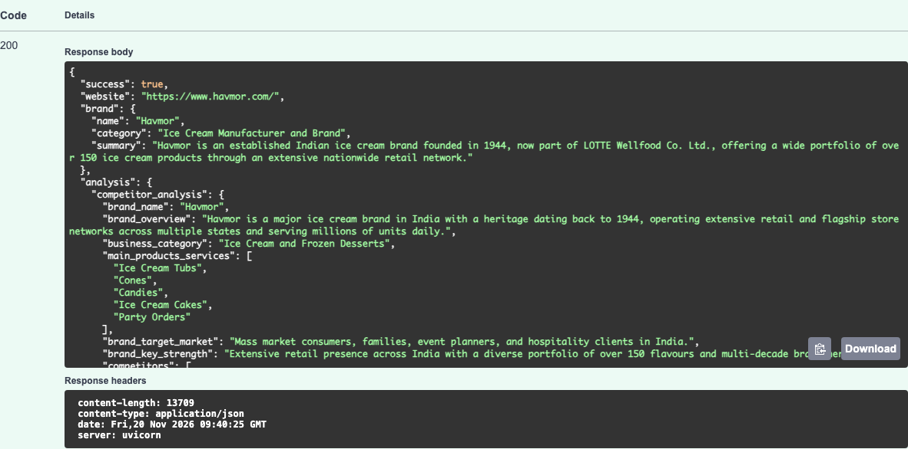
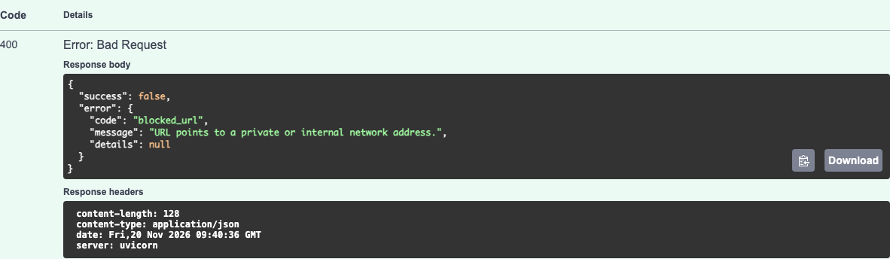
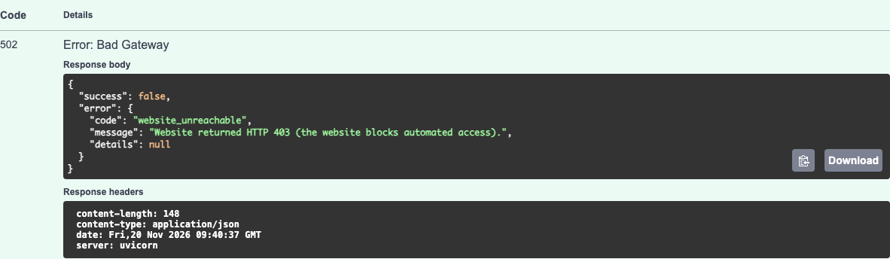

# AI-Powered Website Link Analysis API

A FastAPI service that reads a website, understands it with an LLM (**Google Gemini**) and
returns a structured JSON analysis in five sections: **competitor analysis**, **top 5 target
search queries**, **SEO improvements**, **top 5 services** and **target audience**.

| | |
|---|---|
| Endpoint | `POST /link-analysis` |
| Local | `http://localhost:4000/link-analysis` · docs `http://localhost:4000/docs` |
| **Live demo** | **https://dxora-link-analysis-s0b4.onrender.com** |
| **Live API endpoint** | `POST https://dxora-link-analysis-s0b4.onrender.com/link-analysis` |
| **Live API docs** | **https://dxora-link-analysis-s0b4.onrender.com/docs** |
| Stack | Python 3.10+ (tested on 3.12), FastAPI, Uvicorn, Pydantic v2, HTTPX, BeautifulSoup, Gemini API |

---

## 1. How it works

```text
POST {"url": "..."}
  1. Validate URL ............ scheme, domain, port, credentials, private IPs   (utils/validators.py)
  2. Resolve DNS + SSRF check  every IP must be public; connect to that IP     (website_extractor.py)
  3. Fetch HTML .............. timeouts, size cap, HTML only, redirects re-checked
  4. Extract content ......... title, meta, Open Graph, JSON-LD, headings, nav, main text, footer
                               + up to 3 key internal pages (services / about / products)
  5. Clean & trim ............ remove scripts/styles/cookie banners, de-duplicate, token budget
  6. LLM analysis ............ Gemini, JSON Schema structured output                (llm_service.py)
  7. Validate ................ Pydantic; invalid output -> 1 retry with the errors as feedback
  8. Post-process ............ competitor clean-up + comparison table, SEO lengths (competitor_service.py)
  9. Respond ................. structured JSON + data notes + measured tokens/cost/latency
```

One LLM call produces all five sections (cheaper and more consistent than five calls).
Results are cached per URL for 1 hour.

### Accuracy and honesty rules

- Brand facts, services, SEO findings and audience are generated **only from the extracted
  website text** (the prompt forbids inventing prices, clients, locations or numbers).
- **Competitors** come from the model's general knowledge, so each one is labelled
  `source: "ai_suggestion"` (or `"mentioned_on_website"` if the site names it) with a
  `confidence` level. The brand itself, duplicates and malformed URLs are removed.
- **No search volumes, rankings or traffic numbers** are ever returned - no search-volume
  data source is connected, and the schema has no field for them.
- **Services** are marked `source: "website"` or `"inferred"` (recommendation).
- Every response contains `data_notes` explaining how each part was produced, and `meta`
  with the **measured** token usage, cost and latency of that request.

---

## 2. Project structure

```text
dxora-link-analysis/
├── app/
│   ├── main.py                     # FastAPI app, route, error handlers, rate limit
│   ├── config.py                   # Settings from env vars + official model prices
│   ├── schemas.py                  # Request, LLM output schema, response models
│   ├── errors.py                   # Error types -> HTTP status + error code
│   ├── services/
│   │   ├── website_extractor.py    # SSRF-safe fetching + HTML content extraction
│   │   ├── llm_service.py          # Gemini REST client, structured output, fallback
│   │   ├── analysis_service.py     # Orchestration, prompt, validation, retry, cache
│   │   └── competitor_service.py   # Competitor clean-up, labels, comparison table
│   └── utils/
│       ├── validators.py           # URL validation, public-IP checks
│       └── cache.py                # TTL cache + rate limiter
├── tests/
│   └── test_link_analysis.py       # 58 tests, websites/DNS/Gemini mocked
├── docs/                           # Real sample response, server log, screenshots
├── render.yaml                     # Render deployment blueprint
├── .env.example
├── requirements.txt
└── README.md
```

---

## 3. Setup and run

```bash
git clone https://github.com/Jainikkumbhani/dxora-link-analysis.git
cd dxora-link-analysis

python3 -m venv .venv
source .venv/bin/activate            # Windows: .venv\Scripts\activate
pip install -r requirements.txt

cp .env.example .env                 # add your GEMINI_API_KEY
uvicorn app.main:app --host 0.0.0.0 --port 4000
```

Get a free Gemini API key at **https://aistudio.google.com/apikey**.
Open **http://localhost:4000/docs** to try the API in the browser.

### Configuration (`.env`)

| Variable | Default | Purpose |
|---|---|---|
| `GEMINI_API_KEY` | - | **Required.** Gemini API key |
| `GEMINI_MODEL` | `gemini-3.5-flash-lite` | Primary model (free tier) |
| `GEMINI_FALLBACK_MODEL` | `gemini-3.8-flash` | Used automatically if the primary is overloaded / rate limited (free tier) |
| `GEMINI_THINKING_LEVEL` | `low` | Lower = faster and fewer billed thinking tokens |
| `MAX_EXTRA_PAGES` | `3` | Internal pages fetched besides the homepage |
| `MAX_CONTENT_CHARS` | `14000` | Website text sent to the LLM (cost control) |
| `CACHE_TTL_SECONDS` | `3600` | Cache duration per URL |
| `RATE_LIMIT_PER_MINUTE` | `10` | Requests per client IP per minute (0 = off) |
| `TRUST_PROXY_HEADERS` | `false` | Use `X-Forwarded-For` (enable behind Render's proxy) |

---

## 4. API

### Request

```bash
curl -X POST http://localhost:4000/link-analysis \
  -H "Content-Type: application/json" \
  -d '{"url": "https://stripe.com"}'
```

`example.com` without a scheme is accepted and treated as `https://example.com`.

### Response (shape)

Real response for `{"url": "https://www.havmor.com"}` (Gemini 3.5 Flash-Lite, shortened with `...`). Full response: [`docs/sample-response.json`](docs/sample-response.json), server log: [`docs/sample-server-log.txt`](docs/sample-server-log.txt).

```json
{
  "success": true,
  "website": "https://www.havmor.com/",
  "brand": {
    "name": "Havmor",
    "category": "Ice Cream Brand & Manufacturer",
    "summary": "Established in 1944 and part of LOTTE Wellfood Co. Ltd., Havmor is a leading Indian ice cream brand offering over 150 products across a vast retail network of 72,000 outlets and flagship stores."
  },
  "analysis": {
    "competitor_analysis": {
      "brand_overview": "Havmor Ice Cream is an iconic Indian brand producing millions of units daily, offering traditional kulfis, modern flavors, cakes, and tubs, backed by Lotte Group.",
      "business_category": "Ice Cream and Desserts Manufacturer",
      "main_products_services": [
        "Ice Cream Tubs",
        "Ice Cream Cones",
        "Ice Candies and Pops",
        "..."
      ],
      "competitors": [
        {
          "name": "Amul",
          "website": "https://amul.com/",
          "main_service": "Dairy and Ice Cream Manufacturing",
          "target_market": "Mass market consumers across India",
          "strengths": [
            "Massive nationwide distribution",
            "Strong brand loyalty",
            "Competitive pricing"
          ],
          "weaknesses_or_gaps": [
            "Less focus on premium international dessert variants compared to specialty players"
          ],
          "confidence": "high",
          "source": "ai_suggestion"
        },
        "... 2 more"
      ],
      "strengths": [
        "Heritage dating back to 1944 with strong consumer trust",
        "Diverse product portfolio of over 150 items including traditional kulfis and premium cakes",
        "..."
      ],
      "opportunities": [
        "Expand digital direct-to-consumer delivery infrastructure",
        "Grow flagship store presence into unrepresented states",
        "..."
      ],
      "comparison_table": [
        {
          "competitor_name": "Amul",
          "rows": [
            {
              "comparison": "Brand Name",
              "your_brand": "Havmor",
              "competitor": "Amul"
            },
            {
              "comparison": "Main Service",
              "your_brand": "Ice Cream Tubs",
              "competitor": "Dairy and Ice Cream Manufacturing"
            },
            {
              "comparison": "Target Market",
              "your_brand": "Mass consumer market, families, event planners, and hospitality institutions across India.",
              "competitor": "Mass market consumers across India"
            },
            "..."
          ]
        },
        "..."
      ]
    },
    "target_search_queries": [
      {
        "query": "best ice cream brands in India",
        "platforms": [
          "Google",
          "Facebook"
        ],
        "intent": "Service Search",
        "business_relevance": "Captures users looking for top-tier ice cream options where Havmor is a prominent player.",
        "target_audience": "Ice cream lovers and families"
      },
      {
        "query": "Havmor ice cream party order online",
        "platforms": [
          "Google",
          "Instagram"
        ],
        "intent": "Transactional Search",
        "business_relevance": "Directly targets customers wanting to book party orders for events and celebrations.",
        "target_audience": "Event planners and hosts"
      },
      "... 3 more"
    ],
    "seo_improvements": {
      "primary_keyword": "Havmor ice cream",
      "secondary_keywords": [
        "ice cream flavors",
        "ice cream cake",
        "party order ice cream",
        "best ice cream brand"
      ],
      "long_tail_keywords": [
        "buy Havmor ice cream online",
        "Havmor ice cream party orders",
        "traditional kulfi falooda ice cream"
      ],
      "recommended_title": "Havmor Ice Cream | Delicious Flavours & Party Orders",
      "title_structure": "Primary Keyword | Brand Description",
      "meta_description": "Discover delicious ice cream flavours, cakes, and party orders from Havmor. Established in 1944, now part of Lotte. Find a store near you today!",
      "issues_found": [
        "Homepage has 0 H1 headings, impacting structural SEO hierarchy.",
        "Current homepage title is too short ('| Havmor') and lacks descriptive keywords.",
        "Meta description exceeds optimal length limits."
      ],
      "current_title": "| Havmor",
      "recommended_title_length": 52,
      "supporting_content": [
        {
          "content_type": "Service landing page",
          "title": "Ice Cream Party Orders & Catering",
          "description": "Book bulk ice cream and custom orders for weddings, birthdays, and anniversaries.",
          "target_keyword": "party order ice cream"
        },
        "..."
      ]
    },
    "top_services": [
      {
        "service_name": "Retail Ice Cream Sales",
        "description": "Wide variety of packaged ice creams including tubs, cones, cups, and candies available across retail outlets.",
        "target_industry": "FMCG / Retail",
        "target_customer": "General consumers and families",
        "main_benefit": "Instant access to high-quality, delicious desserts.",
        "source": "website"
      },
      "... 4 more"
    ],
    "target_audience": {
      "primary_audience": [
        "Ice cream lovers",
        "Families",
        "Children and youth",
        "Event hosts"
      ],
      "secondary_audience": [
        "Hotel and restaurant procurement managers",
        "Retail franchise investors",
        "Party planners"
      ],
      "industries": [
        "FMCG",
        "Hospitality",
        "Events & Catering",
        "Food & Beverage Retail"
      ],
      "geographic_focus": [
        "India"
      ],
      "geographic_focus_source": "website",
      "customer_needs": [
        "High-quality, hygienic ice cream products",
        "Wide variety of traditional and modern flavours",
        "Reliable bulk supply for events"
      ],
      "recommended_segments": [
        {
          "audience": "Families",
          "business_type": "B2C Retail",
          "requirement": "Diverse flavor options for home consumption",
          "recommended_channels": [
            "Instagram",
            "Facebook",
            "Google"
          ]
        },
        "..."
      ]
    }
  },
  "data_notes": [
    "Brand, services, SEO and audience insights were generated by gemini-3.5-flash-lite from content extracted from 3 page(s) of the website.",
    "Competitors are AI-generated suggestions based on the model's general knowledge (source 'ai_suggestion'); they are not taken from live market research and should be verified. Competitors named on the website itself are labelled 'mentioned_on_website'.",
    "meta.estimated_cost_usd is the paid-tier equivalent cost; this deployment uses the Gemini free tier, so the actual charge is $0.",
    "Search queries are AI suggestions based on the website content. No search volume, ranking or traffic figures are reported because no search-volume data source is connected.",
    "Services labelled 'inferred' are recommendations, not explicitly offered on the website: Franchise Partnership."
  ],
  "meta": {
    "provider": "Google Gemini",
    "model": "gemini-3.5-flash-lite",
    "pages_analyzed": [
      "https://www.havmor.com/",
      "https://www.havmor.com/about-us",
      "https://www.havmor.com/all-products"
    ],
    "content_characters": 6327,
    "input_tokens": 2242,
    "output_tokens": 3087,
    "estimated_cost_usd": 0.00839,
    "fetch_seconds": 0.85,
    "llm_seconds": 9.51,
    "total_seconds": 10.36,
    "cached": false,
    "analyzed_at": "2026-11-20T09:38:02+00:00"
  }
}
```

### Errors

All errors use the same format: `{"success": false, "error": {"code": "...", "message": "..."}}`

| HTTP | `code` | When |
|---|---|---|
| 422 | `invalid_url` | Not a valid http(s) URL, bad domain, credentials in URL |
| 422 | `validation_error` | Missing / wrong-type `url` field |
| 400 | `blocked_url` | Private, loopback, link-local, metadata or internal address (also via DNS or redirect); non-standard port |
| 502 | `website_unreachable` | DNS failure, connection refused, invalid TLS certificate, HTTP 4xx/5xx (e.g. 403 bot protection), too many redirects |
| 504 | `website_timeout` | Website did not respond in time |
| 422 | `unsupported_content` | URL is not an HTML page (PDF, image, ...) |
| 422 | `insufficient_content` | Too little readable text (e.g. JavaScript-only site) |
| 502 | `llm_error` | LLM authentication error or invalid output after retry |
| 503 | `llm_unavailable` / `llm_rate_limited` / `llm_not_configured` | Models temporarily overloaded / quota exceeded / no API key |
| 504 | `llm_timeout` | LLM did not respond in time |
| 429 | `rate_limited` | Too many requests from one client |

Real examples:

```json
{"success": false, "error": {"code": "blocked_url", "message": "URL points to a private or internal network address."}}
{"success": false, "error": {"code": "website_unreachable", "message": "Website returned HTTP 403 (the website blocks automated access)."}}
{"success": false, "error": {"code": "unsupported_content", "message": "URL does not point to an HTML web page (content type: image/png)."}}
```

### Screenshots

| Swagger UI (`/docs`) | Real analysis (havmor.com) |
|---|---|
|  |  |
| **SSRF attempt blocked** (`169.254.169.254`) | **Bot-protected website** (HTTP 403) |
|  |  |

---

## 5. Security

- **SSRF protection** - only `http`/`https` on ports 80/443; no credentials in URLs;
  `localhost`, `.local`, `.internal` names rejected; **every resolved IP** must be public
  (private, loopback, link-local incl. `169.254.169.254`, reserved, multicast, IPv4-mapped IPv6
  are blocked). The same checks run on **every redirect hop** (followed manually, max 5).
- **DNS rebinding protection** - the request is sent to the IP address that was checked, with
  the original `Host` header and TLS SNI, so certificates are still verified against the domain
  but a second DNS answer cannot point the request at an internal service.
- **Resource limits** - connect/read timeouts, 3 MB page cap (streamed, truncated), HTML only.
- **Secrets** - API key only from environment variables (`SecretStr`), sent in a header (never
  in URLs or logs); `.env` is git-ignored.
- **Abuse / cost protection** - per-IP rate limit (behind Render the client IP comes from
  Cloudflare's `True-Client-IP` / `CF-Connecting-IP`, not the spoofable `X-Forwarded-For`),
  response cache, token budget.
- **Dependencies** - exact versions pinned in `requirements.txt` and scanned with `pip-audit`:
  no known vulnerabilities (2026-11-20).
- **Prompt-injection hygiene** - website text is passed as delimited data; the output must match
  a strict schema and is validated before it is returned.

---

## 6. LLM platform & model research

**Legend:** 🟢 **Measured** = run by this application on real websites ·
🟡 **Estimated** = calculated from official prices and our measured token counts, not run ·
⚪ **Not tested**.

**Sources (official pricing pages, read on 2026-11-20):**
[Gemini API pricing](https://ai.google.dev/gemini-api/docs/pricing) ·
[Gemini models](https://ai.google.dev/gemini-api/docs/models) ·
[OpenAI API pricing](https://developers.openai.com/api/docs/pricing) ·
[OpenAI GPT-5.4 mini/nano announcement](https://openai.com/index/introducing-gpt-5-4-mini-and-nano/) ·
[Anthropic pricing](https://platform.claude.com/docs/en/about-claude/pricing) ·
[Anthropic models](https://platform.claude.com/docs/en/models/overview).
Prices change often - check these pages before production use.

### A. Benchmark (measured)

Setup: 2026-11-20, this API running locally (India), Gemini API **free tier**, thinking
level `low`, same prompt and schema, fallback disabled so every number belongs to one model.
5 websites of different types: `stripe.com` (fintech), `zoho.com` (SaaS suite),
`basecamp.com` (SaaS), `freshworks.com` (SaaS), `havmor.com` (Indian FMCG / ice cream).
One run per site and model - a small sample, so treat the numbers as indicative.

| Model | Successful analyses | LLM time (avg / min-max) | End-to-end time (avg) | Input tokens (avg / range) | Output tokens incl. thinking (avg / range) |
|---|---|---|---|---|---|
| `gemini-3.5-flash-lite` | 🟢 **5 / 5** | 🟢 **8.9 s** / 8.5-9.4 s | 🟢 **10.2 s** | 🟢 3,332 / 2,242-3,787 | 🟢 3,003 / 2,820-3,207 |
| `gemini-3.8-flash` | 🟢 0 / 6 - HTTP 503 "high demand" or no answer within 90 s | - | - | - | - |
| `gemini-4-hydrogen` | 🟢 0 / 6 - HTTP 503 "high demand" or no answer within 60-90 s | - | - | - | - |

**Accuracy (manual review of the 5 Flash-Lite outputs - qualitative, not a formal benchmark):**
brand name and category correct 5/5; all 25 services exist on the websites and were labelled
`website`; all 15 competitors are real, relevant companies (e.g. Havmor → Amul, Vadilal,
Kwality Wall's; Basecamp → Asana, Monday.com, Trello); facts quoted in summaries (e.g. Havmor
"since 1944", "part of Lotte") appear in the extracted text; SEO issues found were real
(e.g. Havmor homepage has no H1 and a title of only "| Havmor"); every query respected the
5-platform list and no search volumes were produced. Recommended SEO titles were 42-59
characters (target 50-60) and meta descriptions 143-165 characters (target 140-160).

### B. LLM platform comparison

Cost per analysis = average measured usage of this app (**3,332 input + 3,003 output tokens**)
× the official price. Other providers' tokenizers differ, so their figures are estimates (±20%).

| Provider | Model | API cost (input / output per 1M) | Free tier | Response speed | Accuracy for this task | Context window | JSON support | Cost per analysis | Recommendation |
|---|---|---|---|---|---|---|---|---|---|
| Google | `gemini-3.5-flash-lite` | $0.30 / $2.50 | ✅ Yes | 🟢 8.9 s | 🟢 Good (manual review above) | 1,048,576 | Native JSON Schema (`responseJsonSchema`) | 🟢 **$0.0085** (free tier: $0) | ✅ **Selected (primary)** |
| Google | `gemini-3.8-flash` | $0.75 / $3.75 (promo until 2026-12-31, then $1.50 / $7.50) | ✅ Yes | 🟢 Unavailable during test (503) | ⚪ Not measured | 1,048,576 | Native JSON Schema | 🟡 $0.0138 (from 2027: $0.0275) | Fallback model |
| Google | `gemini-4-hydrogen` | $1.50 / $7.50 | ✅ Yes | 🟢 Unavailable during test (503 / timeout) | ⚪ Not measured | 1,048,576 | Native JSON Schema | 🟡 $0.0275 | Not needed for this task |
| Google | `gemini-4-carbon` (Pro) | $2.00 / $10.00 (from 2026-12-01: $4.00 / $20.00) | ❌ No | ⚪ | ⚪ | 1,048,576 | Native JSON Schema | 🟡 $0.0367 (from Dec: $0.0734) | Too expensive for this task |
| OpenAI | `gpt-6-luna` | $0.10 / $0.50 | ❌ No | ⚪ | ⚪ | Not stated on pricing page | Structured Outputs (JSON Schema) | 🟡 $0.0018 | Cheapest on paper - benchmark before using |
| OpenAI | `gpt-5.4-nano` | $0.20 / $1.25 | ❌ No | ⚪ | ⚪ | 400K | Structured Outputs | 🟡 $0.0044 | Candidate for paid deployment |
| OpenAI | `gpt-5.4-mini` | $0.75 / $4.50 | ❌ No | ⚪ | ⚪ | 400K | Structured Outputs | 🟡 $0.0160 | Higher quality option, higher cost |
| Anthropic | `claude-haiku-5-5` | $0.10 / $0.50 (prompts ≤100K tokens) | ❌ No | ⚪ | ⚪ | 1M | Structured outputs / tool use | 🟡 $0.0018 | Cheapest on paper - benchmark before using |
| Anthropic | `claude-sonnet-5-5` | $2.00 / $10.00 | ❌ No | ⚪ | ⚪ | 1M | Structured outputs / tool use | 🟡 $0.0367 | Strong reasoning, too expensive here |

Only Gemini models were benchmarked because this project is built on a free budget: the
Gemini API is the only one of the three with a free tier, so OpenAI and Anthropic models
were compared on official prices and documentation only.

### C. Best model selection

| Criterion | `gemini-3.5-flash-lite` |
|---|---|
| 1. Accuracy on website content | Good: correct brand, real services, relevant competitors, grounded facts (5/5 sites) |
| 2. Response time | ~9 s LLM, ~10 s end-to-end (measured) |
| 3. API cost | $0 on the free tier; $0.0085 per analysis on the paid tier |
| 4. Reliable structured JSON | 5/5 valid against the strict schema on the first attempt (native JSON Schema mode) |
| 5. Competitor and SEO insight | Relevant competitors with labelled confidence; SEO issues taken from real page facts |
| 6. Large website content | 1M-token context; we send only ~3.3K tokens after cleaning |

It was also the **only free-tier model that answered reliably** during the benchmark; larger
free models were overloaded. A model that is cheaper on paper but not available is not useful
for a live demo.

### D. Cost optimisation

Implemented in this project:

| Technique | Where | Effect |
|---|---|---|
| Clean HTML before sending (remove scripts, styles, SVG, forms, cookie banners, nav duplicates) | `website_extractor.py` | Only readable business text is sent |
| De-duplicate lines, hard budget of 14,000 characters (~3.3K tokens) | `website_extractor.py` | Input stays ~2-4K tokens even for big sites |
| Only 3 key internal pages (services / about / products) | `pick_extra_pages` | Better content without crawling the whole site |
| **One LLM call** for all five sections | `analysis_service.py` | Website text is paid for once, not five times |
| Compact JSON Schema (titles / defaults / examples removed, server-filled fields excluded) | `build_llm_schema` | Fewer tokens, shorter output |
| Low thinking level | `GEMINI_THINKING_LEVEL=low` | Fewer billed thinking tokens, faster |
| Cache per URL (1 hour) | `TTLCache` | Repeated requests cost nothing (measured: cache hit, no LLM call) |
| Fail **before** the LLM call for unusable sites (403, PDF, JS-only, blocked URL, missing key) | `analysis_service.py` | No tokens spent on errors |
| Retry only on invalid output, fallback model only on failure | `llm_service.py` | No unnecessary repeated calls |
| Per-IP rate limit | `main.py` | Protects the free quota on the public demo |

Further options for higher volume: Gemini context caching of the fixed system prompt + schema;
the Batch API (50% cheaper) for bulk analyses; a persistent cache (e.g. Redis) shared between
instances; a two-tier pipeline (small model for extraction/summary, larger model only for the
competitor section) if quality on competitors needs to improve.

### E. Final LLM recommendation

| Item | Recommendation |
|---|---|
| **Recommended provider** | Google Gemini API (Google AI Studio) |
| **Recommended model** | `gemini-3.5-flash-lite` |
| Estimated input tokens | ~3,300 per analysis (🟢 measured avg 3,332; range 2,242-3,787) |
| Estimated output tokens | ~3,000 per analysis incl. thinking (🟢 measured avg 3,003; range 2,820-3,207) |
| Estimated cost per analysis | **$0 on the free tier**; $0.0085 paid tier (= ~$8.50 per 1,000 analyses) |
| Expected response time | 🟢 ~10 s end-to-end (~9 s LLM + ~1-3 s fetching); cached repeats instantly |
| Reason | Only free-tier model that was reliably available; valid structured JSON 5/5; accurate, site-specific output; low cost; 1M context |
| Fallback model | `gemini-3.8-flash` (free tier, newer Flash model) - used automatically when the primary is rate limited or overloaded |
| Balancing accuracy, speed and cost | Keep a fast, cheap model as default; reduce input with cleaning + token budget; one call for all sections; cache; switch to the fallback only on failure. For a paid production deployment, run this same benchmark on `claude-haiku-5-5` and `gpt-6-luna` (both ~$0.0018 per analysis on paper) and choose by measured accuracy and latency. |

---

## 7. Tests

```bash
pip install pytest
pytest -q
```

58 tests, no network or API key needed (websites, DNS and Gemini are simulated with
`httpx.MockTransport`). Covered:

- URL validation and SSRF: private/loopback/metadata/IPv6/mapped addresses, ports, DNS
  answers with a private IP, redirects to private IPs, too many redirects, **requests pinned to
  the validated IP**;
- website errors: 403, 500, PDF, JavaScript-only page, timeout, oversized page;
- HTML extraction: meta, Open Graph, JSON-LD, headings, nav, footer, social links, script /
  cookie-banner removal, de-duplication, choice of extra pages;
- LLM: prompt contains real site content, JSON Schema sent, invalid output retried with
  feedback, invalid twice -> 502, rate limit -> fallback model, overload -> primary retried
  then fallback, all models overloaded -> 503, quota on all models, invalid key (not leaked), schema rejected -> prompt schema, timeout, missing key;
- post-processing: competitor de-duplication / brand removal / labels, comparison table,
  platform aliases (`Twitter` -> `X`), cost calculation;
- cache, rate limit, client-IP detection behind a proxy, health, 404/405 JSON errors.

---

## 8. Deployment (Render)

`render.yaml` is a Render Blueprint:

1. Push this repository to GitHub.
2. On **render.com** → **New** → **Blueprint** → select the repository.
3. Enter `GEMINI_API_KEY` when asked (it is stored in Render, not in the repository).
4. Render runs `pip install -r requirements.txt` and starts
   `uvicorn app.main:app --host 0.0.0.0 --port $PORT`; health check: `/health`.

The free plan sleeps after inactivity, so the first request after a pause can take ~1 minute.

**Deployed:** https://dxora-link-analysis-s0b4.onrender.com (free plan, `gemini-3.5-flash-lite`,
rate limit 5 analyses per minute per client IP). Try it from `/docs` → `POST /link-analysis` →
*Try it out*.

```bash
curl -X POST https://dxora-link-analysis-s0b4.onrender.com/link-analysis \
  -H "Content-Type: application/json" \
  -d '{"url": "https://basecamp.com"}'
```

---

## 9. Design decisions and assumptions

- **Retry strategy** - a temporary 503 ("high demand") on the primary model is retried once after
  2 s before switching to the fallback model, because such spikes are short (seen in testing);
  quota errors (429) and timeouts switch to the fallback immediately.
- **One LLM call for all five sections** - shared context, consistent output, one input-token
  charge instead of five.
- **REST API via HTTPX instead of an SDK** - fewer dependencies, full control over timeouts,
  retries and error mapping.
- **Static HTML only** - pages that need JavaScript to render return
  `insufficient_content` instead of a guessed analysis.
- **Exactly 5 queries and 5 services** are enforced by the schema; competitors target 3-5
  but fewer are allowed (with a note) when reliable information is limited.
- **Free of charge** - the Gemini free tier and Render free plan are used. `meta.estimated_cost_usd`
  reports the paid-tier equivalent (measured tokens × official price); the actual charge is $0.
- **Cached responses** return the original analysis with `meta.cached: true` (timings are those of
  the original run).
- Bot-protected sites (e.g. returning HTTP 403) are reported as such - the API does not try to
  bypass access restrictions.
